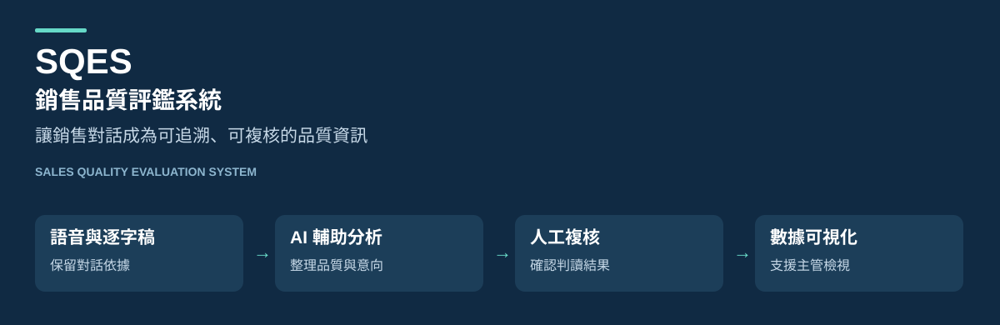

# SQES｜銷售品質評鑑系統

**Sales Quality Evaluation System · 語音質檢 × 客戶意向 × 數據可視化**

將銷售對話整理成可追溯、可複核、可視化的品質資訊，協助主管了解接待流程與顧客關注重點，讓團隊討論有具體依據。

SQES 是面向汽車展間接待情境的內部 Demo 工具。本倉庫提供產品介紹與展示素材；完整應用程式採非開源方式維護，另提供使用虛構資料的互動展示網站，完整應用程式未提供公開安裝包。

**[開啟互動展示網站](https://lnsy116.github.io/sqes-showcase/)**

[功能與操作導覽](docs/PRODUCT_TOUR.md) · [驗證成果與範圍](docs/VALIDATION.md) · [虛構資料說明](examples/README.md)

## 從對話到可檢視的結果

**錄音 → 逐字稿 → AI 初評 → 人工複核 → 儀表板與報告**

| 面向 | 提供的能力 | 展示時可觀察的重點 |
| --- | --- | --- |
| 單場錄音質檢 | 逐字稿、接待 SOP 與 FAB 話術檢視 | 由判定回看對應原話與原音 |
| 顧客意向 | 以量規整理購車意向與支持證據 | 分開呈現初評、待確認與人工複核 |
| 人工複核 | 檢視判讀、修改結果、保存歷程 | 保留 AI 原判與人工調整紀錄 |
| 門市總覽 | 場次搜尋、顧問比較與雷達圖 | 查看各項表現，辨識尚未完成複核的案例 |
| 顧客洞察 | 顧客原話的關注主題、認可與疑慮 | 避免把未擷取到意見解讀為滿意 |
| 成果匯出 | Excel 點檢表、HTML 報告、PNG 圖表 | 便於檢視、會議說明與結果留存 |

FAB 指 Feature（特徵）、Advantage（優勢）、Benefit（利益）的銷售說明方式。

## 展示預覽

> 這張圖是為公開介紹重新繪製的靜態示意圖，並非實際介面截圖。六筆案例、分數與顧問代號均為人工編造，未由客戶資料匿名化或抽樣取得。示意分數不代表模型效能、實際客戶意向或員工績效。

示意圖與 [公開虛構資料](examples/synthetic-cases.json) 對應，讓讀者了解資料如何被組織；完整操作流程見 [產品導覽](docs/PRODUCT_TOUR.md)。

## 設計重點

- **判定有依據：** 將逐項結果連回對話證據，支援人工回看。
- **狀態有區別：** AI 初評與待複核結果明確標記，未完成案例不作正式總分排名。
- **畫面與匯出一致：** 以同一份有效結果產出畫面與即時 Excel，圖表下載保留標題與圖例。
- **瀏覽不觸發重新評分：** 查看已保存結果與下載報告不額外呼叫評分模型。

## 技術概覽

以 **Python / FastAPI** 組織後端處理，搭配本機語音轉錄、可設定的 LLM 服務、規則計分與人工複核流程；前端以 **HTML / JavaScript / Chart.js** 呈現分析結果，並提供 Excel 與圖表匯出。

此處僅介紹技術組成，不公開程式實作、Prompt、評分規則、配分與校準設定。

## 已完成的驗證

2026-10-19 的電腦 Demo 驗收與來源快照測試包含：

| 項目 | 紀錄結果 |
| --- | --- |
| Python 自動化測試 | 322 項通過 |
| 前端邏輯測試 | 44 項通過 |
| 資料一致性檢查 | 64 項通過 |
| Excel 公式驗證 | 3 份匯出、共 381 個公式，包含原生 Excel 重算 |
| 電腦展示操作 | Edge 操作、圖表互動、PNG 實際下載與開啟完成 |

這些是指定版本、指定環境的功能驗證紀錄，**不代表 AI 判讀準確率、成交預測能力或生產環境認證**。詳細範圍與限制見 [驗證摘要](docs/VALIDATION.md)；原始測試與個案證據留在非公開環境。

## 公開範圍

本倉庫包含介紹文件、原創展示插圖、獨立展示網頁與人工編造的範例資料。實際錄音、逐字稿、客戶資訊、內部點檢表、應用程式原始碼、模型連線設定與金鑰均不隨此倉庫提供。

本倉庫不是完整軟體的開源發行，也不授予完整應用程式的使用授權。公開素材的說明見 [NOTICE.md](NOTICE.md)。

GitHub Pages 提供系統介紹與獨立互動看板，支援顧問／狀態篩選、案例搜尋、案例洞察、圖表比較、可展開的 SOP／FAB 點檢明細、顧客主題導覽、痛點與需求／偏好文字雲，以及虛構資料 JSON 下載。展示網頁的 HTML、CSS 與 JavaScript 可公開檢視，完整 SQES 應用程式仍另行維護。
