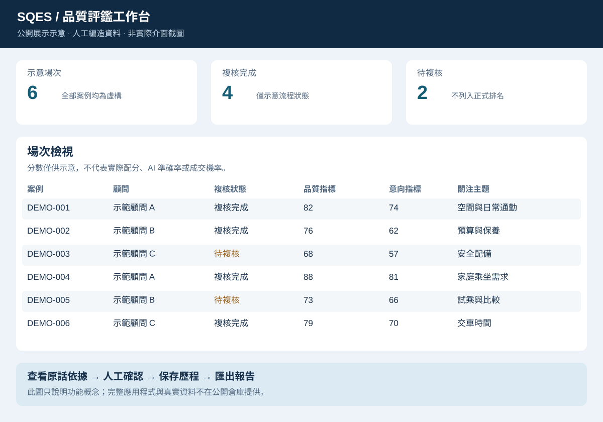

# SQES 功能與操作導覽

[回到專案首頁](../README.md)

這份導覽說明完整應用程式的主要操作流程。[公開互動看板](https://lnsy116.github.io/sqes-showcase/) 可使用虛構案例體驗篩選、搜尋、案例切換與圖表比較；完整系統的錄音、分析與人工複核流程由下文介紹。

## 1. 選擇一場接待對話

在單場錄音質檢中選擇場次，查看處理狀態與逐字稿；需要時播放原音。已保存的分析可直接查看，案例切換時畫面會同步更新，避免殘留上一場分數。

## 2. 閱讀 AI 初評與對話依據

分析結果涵蓋接待流程、FAB 話術與顧客意向。展開點檢項目可查看對應原話與上下文，必要時回到原音。缺少證據、角色不明或無法從錄音觀察的項目，須另行確認。

意向指標用來組織量規評估，不是成交機率。顧客關注、疑慮與認可屬於原話觀察，也不等同問卷滿意度。

## 3. 完成人工複核

逐項檢視判讀、調整判定與分數並保存；系統保留 AI 原判與修改歷程。尚未完成複核的案例維持明確狀態，不應用於正式總分排名。

## 4. 查看門市總覽與顧客洞察

透過搜尋、顧問比較、雷達圖與顧客關注主題，整理需要跟進或訓練的方向。圖表可放大、縮放與重設，便於電腦上的會議展示。

圖中案例完全虛構。公開圖採簡化布局，不表示完整應用程式的實際欄位、精確配分或畫面布局。

## 5. 匯出供會議檢視的成果

下載 Excel 點檢表、HTML 報告或 PNG 圖表，保留結果與必要狀態說明。圖表匯出包含標題與圖例；Excel 可檢視公式與人工複核資訊。

## 建議的兩分鐘講解順序

1. **先說用途：** 把接待對話整理成可複核的品質資訊。
2. **說明單場分析：** 重點在判定依據與人工確認流程。
3. **切到總覽：** 說明如何觀察顧問與流程差異。
4. **展示匯出：** 說明如何帶進主管會議與後續追蹤。
5. **交代範圍：** 目前為內部 Demo；公開素材採虛構資料，AI 準確率尚需另行評估。

## 公開版可操作的點檢與洞察

在互動看板的「探索單場接待的判讀依據」區域選擇案例，可展開六項人工編寫的示範題目，依判定狀態篩選，查看 SOP 與 F／A／B 的示意判讀及引用原話。支援全部展開與收合。

下方「顧客洞察」提供主題導覽、顧客痛點及需求／偏好文字雲。點選主題或詞語，右側顯示同一案例的支持原話與跟進方向。案例切換時所有內容同步更新；沒有符合篩選的案例時清空。此處只展示明確表達的需求與偏好，不推論人格或成交難易。
